# Node AirQ — Qualidade do Ar + Analisador de Ar-Condicionado

Variante do Aguada Node para ambientes internos. Mede **qualidade do ar, conforto
térmico, luminosidade e ruído** e, com as sondas opcionais, funciona como
**analisador de ar-condicionado** (ΔT ambiente−insuflamento, temperatura de entrada
da condensadora, corrente/estado do compressor). Publica por ESP-NOW → gateway →
MQTT/HA e serve um **captive portal WiFi** local (sem broker).

**Princípio:** caixa central + periféricos opcionais. Tudo é detectado em runtime —
sem sondas/TC/SCD41 o device funciona como o AirQ original, e a bridge só cria no HA
as entidades dos periféricos que existem.

- **MCU:** ESP32-C3 SuperMini
- **Modo:** `sensor_type = AIR_QUALITY (1)`, `relay_enabled = true`, `num_sensors = 1`
- **Env PlatformIO:** `ani-01-c3`
- **AP captive:** `ANI-{node_id}` (ex.: `ANI-0494`) → `http://192.168.4.1`
- **node_id:** 2 últimos bytes do MAC (ex.: `0x0494`)

---

## Componentes

| Componente | Interface | GPIO | Mede | Obrigatório | Estado |
|---|---|---|---|---|---|
| **AHT21** | I2C `0x38` | SDA 6 / SCL 7 | T, UR ambiente | sim | ✅ validado |
| **ENS160** | I2C `0x52` | SDA 6 / SCL 7 | eCO₂ *estimado*, TVOC, AQI | sim | ✅ validado |
| **SCD41** | I2C `0x62` | SDA 6 / SCL 7 | **CO₂ real (NDIR)** | não | 🟡 código pronto, validar em bancada |
| **DS18B20 EXT** | 1-Wire | 4 (barramento único) | T do ar de entrada da condensadora | não | 🟡 idem |
| **DS18B20 SUP** | 1-Wire | 4 (mesmo fio DQ) | T do ar de insuflamento | não | 🟡 idem |
| **SCT-013 (TC)** | ADC1 | 1 | corrente da condensadora | não | 🟡 idem |
| **TEMT6000** | ADC1 | 3 | luminosidade | não | ✅ validado |
| **INMP441** | I2S | SCK 20 / WS 21 / SD 5 | ruído, dB(A) | não | 🟡 idem (substitui o KY-037) |

> ⚠️ **eCO₂ do ENS160 não serve para a RE 09/2003** — é estimado a partir de VOC.
> Para o limite de 1000 ppm de CO₂ é preciso o **SCD41**.
>
> ⚠️ **AHT21 na placa combinada com o ENS160** costuma ler +2 a +4 °C (o ENS160 tem
> aquecedor). É a referência de "ambiente" do ΔT → medir o desvio contra um termómetro
> de referência; se for grande, afastar o AHT21 ou usar uma 3ª sonda no retorno.

---

## Diagramas de ligação







### Alimentação por bateria (opcional)

- Li-ion 3,7 V → **TP4056 com proteção (DW01)** B+/B−; carga pelo USB-C do TP4056.
- OUT+ → **SW1** (liga/desliga) → **D1 Schottky SS34** → pino **5V** do C3 (LDO onboard → 3,3 V).
  D1 impede que o 5 V do USB do C3 (ao gravar firmware) volte para a bateria.
- Divisor **100k/100k** depois do SW1 → **GPIO0** (VBAT/2, 4,2 V → 2,1 V; não drena com SW1 aberto).
  Firmware: `vbat_enabled=true` (pino 0 e divisor 2 já são os padrões) via CMD_CONFIG do gateway.
- **SW2** no 3V3 do C3 corta todos os sensores. ENS160/AHT21 só são detectados no boot →
  religar SW2 com o C3 ligado exige reboot. Para economia de verdade, preferir P-MOSFET comandado
  por GPIO (ex. AO3401) em vez de chave manual.
- Autonomia com portal Wi-Fi sempre ligado: ~120–130 mA → ~1 dia com 18650 de 2500 mAh.
  Abaixo de ~3,6 V na bateria o 3,3 V começa a cair (D1 + LDO).

Versão completa (foto da bancada anotada + checklist de soldagem):
[`firmware/node/docs/airq_ligacoes.html`](firmware/node/docs/airq_ligacoes.html) — abrir
no browser. Os diagramas são gerados por `firmware/node/docs/wiring_src/` (não editar à mão).

## Pinagem (ESP32-C3 SuperMini)

| GPIO | Função | Notas |
|---|---|---|
| 0 | VBAT/2 (opcional) | ADC1 — divisor 100k/100k da bateria (após SW1) |
| 1 | **TC (SCT-013)** | ADC1. Bias ~1.34 V (10k/6k8 + 10 µF), jack P2 com comutação → GND sem plugue |
| 2 | livre | strapping — evitar |
| 3 | TEMT6000 SIG | ADC1 |
| 4 | **Sondas EXT + SUP + RET** DS18B20 | barramento 1-Wire único, **um** pull-up 4k7 → 3V3 |
| 5 | **INMP441 SD** | entrada; pull-down interno activado |
| 6 / 7 | I2C SDA / SCL | AHT21 + ENS160 + SCD41. **ENS160 CS→3V3** |
| 8 | LED onboard | strapping |
| 9 | BOOT | HELLO / restart |
| 10 | livre | (era a sonda SUP) |
| 20 | **INMP441 SCK** | (U0RXD — livre, consola vai pela USB) |
| 21 | **INMP441 WS** | (U0TXD — a ROM escreve log no boot; inofensivo como WS) |

INMP441: VDD 3V3, GND, **L/R → GND** (canal esquerdo). Sem microfone → lê zeros → "falha".

Todos os pinos são overridable por build flag: `CT_PIN`, `PROBE_PIN`, `MIC_SCK_PIN`, `MIC_WS_PIN`, `MIC_SD_PIN`, `DEFAULT_LIGHT_PIN`;
calibração: `CT_AMPS_PER_VOLT` (30 = SCT-013-030), `CT_NOISE_MV`, `MIC_DB_OFFSET`.

### Sondas em cabo (hardware recomendado)

- DS18B20 encapsulado inox, cabo 3 vias (VDD/DQ/GND) — **não usar modo parasita**.
- Conector M8 3 pinos ou RJ11 (evitar P2 3,5 mm: faz curto ao inserir).
- Barramento: TVS (ex. ESD5Z3.3) + resistor série 100 Ω no DQ de cada conector.
- **Até 3 sondas no mesmo GPIO** (EXT, SUP, RET): o papel é amarrado ao ID ROM de cada
  DS18B20 e gravado em NVS. Sonda nova ocupa o primeiro papel livre (EXT → SUP → RET);
  Para saber qual é qual: **Identificar sondas** no portal (5 min, leitura a 1 s). Aqueça
  UMA sonda com a mão — a que sobe ≥ 1 °C fica destacada ("ESTA"); escolha o papel,
  `atribuir` e cole a etiqueta com o **ID de 4 hex** mostrado (bytes 1–2 da ROM).
  API: `POST /probe_ident?on=1|0`, `GET /probes`, `POST /probe_assign?rom=<16hex>&role=0|1|2`
  (0=EXT 1=SUP 2=RET; se a ROM já tinha papel, os dois trocam).
- **RET** (retorno): na grelha de entrada de ar da evaporadora. Com ela o ΔT passa a ser
  **retorno − insuflamento** (normal 8–12 °C); sem ela, AHT21 da caixa − insuflamento.
- Cabos somados ≲ 5 m (topologia em estrela); acima disso, pull-up 2k2 ou voltar a 2 GPIOs.
- **SUP**: na grelha de saída da evaporadora, no fluxo de ar, sem tocar na aleta.
- **EXT**: na entrada de ar da condensadora (não ao sol, não na descarga quente).

### TC — faixa de medição

ADC do C3 com 11 dB só é linear até ~2.5 V → bias em ~1.34 V dá ±1.2 V de pico
≈ **25 A RMS com o SCT-013-030**. Acima disso o firmware marca `TC SATURADO`
→ usar SCT-013-050/100 e ajustar `CT_AMPS_PER_VOLT`. Medir **uma só fase**
(um condutor dentro do anel, não o cabo inteiro).

---

## Variáveis e canais de rádio

Leitura local a cada **8 s**; envio ESP-NOW a cada `interval_send_s` (**120 s**).
Canais opcionais só são enviados depois do 1º valor válido; se o periférico for
removido passam a enviar "sem leitura" (0xFFFF → `null` no MQTT).

| Variável | Sensor | Pacote ESP-NOW | MQTT `aguada/{id}/airq/state` |
|---|---|---|---|
| eCO₂ + AQI | ENS160 | SENSOR sid 1 (`FLAG_IS_AIR_QUALITY`) | (tópico ANI legado `…/1/state`) |
| T + UR ambiente | AHT21 | HEARTBEAT sid `0xFE` | `t_amb` (+ `…/env/state`) |
| CO₂ real | SCD41 | HEARTBEAT `0xF0` = ppm | `co2` |
| T externa | DS18B20 EXT | `0xF1` = T×10+1000 | `t_ext` |
| T insuflamento | DS18B20 SUP | `0xF2` = T×10+1000 | `t_sup` |
| T retorno | DS18B20 RET | `0xF7` = T×10+1000 | `t_ret` |
| Corrente | SCT-013 | `0xF3` = A×100 | `current_a`, `compressor_on` (≥ 1 A) |
| Luminosidade | TEMT6000 | `0xF4` = lux, reserved = % | `lux`, `lux_pct` |
| Ruído | INMP441 | `0xF5` = dB×10, reserved = pico | `sound_db`, `sound_peak_db` |
| TVOC + AQI | ENS160 | `0xF6` = ppb, reserved = AQI | `tvoc`, `aqi` |
| **ΔT** | derivado (bridge) | — | `dt_c` = `t_amb − t_sup` |

Os canais `0xF0–0xF6` usam o tipo HEARTBEAT que o gateway já repassa tal e qual
(`distance_cm` + `reserved`) → **não precisam de reflash do gateway**.

---

## Diagnóstico do ar-condicionado (captive portal)

| ΔT (ambiente − insuflamento) | Leitura provável |
|---|---|
| insuflamento < 2 °C | risco de congelamento da serpentina |
| < 6 °C (compressor ligado) | pouca carga de gás, compressor fraco, condensadora suja |
| 6–8 °C | abaixo do esperado |
| 8–14 °C | normal |
| > 14 °C | pouca vazão de ar: filtro / evaporadora suja, ventilador |

Com TC ligado e corrente < 1 A, o ΔT não é avaliado (compressor desligado).
Faixas de referência para splits/self em regime; inverter em baixa rotação dá ΔT menor.

---

## Build & flash

```bash
cd firmware/node
~/.platformio/penv/bin/pio run -e ani-01-c3 -t upload --upload-port /dev/ttyACM0
```

---

## Ficheiros

| Ficheiro | Conteúdo |
|---|---|
| `firmware/node/src/ani_sensor.cpp/.h` | AHT21 + ENS160 (I2C) |
| `firmware/node/src/co2_scd41.cpp/.h` | SCD41 — driver próprio, sem lib |
| `firmware/node/src/probe_temp.cpp/.h` | DS18B20 EXT/SUP/RET num barramento, papel por ROM (NVS), hot-plug, conversão não-bloqueante |
| `firmware/node/src/current_ct.cpp/.h` | TC SCT-013 — RMS, detecção de presença e saturação |
| `firmware/node/src/sound_sensor.cpp/.h` | INMP441 (I2S, 32 kHz) — nível RMS e pico **ponderados A** (IIR, janela 0.26 s/tick); amostra >>9 (1 bit de atraso do I2S do C3) |
| `firmware/node/src/light_sensor.cpp/.h` | TEMT6000 |
| `firmware/node/src/main.cpp` | `ani_tick`, `ani_send_extras`, captive `/data`, ESP-NOW |
| `firmware/node/include/ani_web.h` | captive portal (secções escondem-se sem periférico) |
| `firmware/shared/protocol.h` | `SENSOR_ID_CO2 … SENSOR_ID_VOC` (0xF0–0xF6) |
| `tools/bridge.py` | `_handle_airq_channel`, discovery HA, ΔT, compressor |
| `tools/test_airq_channels.py` | testes dos canais AirQ na bridge |
| `firmware/node/docs/airq_wiring_*.svg`, `airq_ligacoes.html` | diagramas de ligação (gerados) |
| `firmware/node/docs/wiring_src/` | gerador dos diagramas (`python3 export_svg.py`) |
| `todo.md` | pendências deste node |
