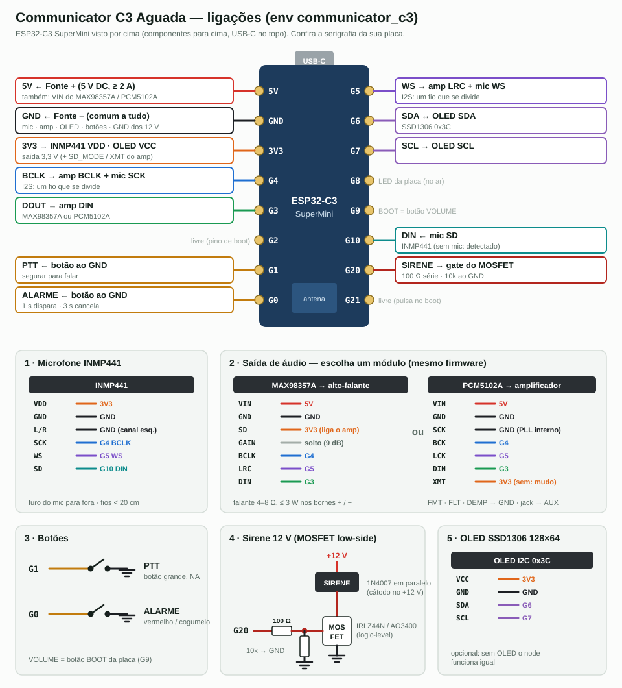

# Manual de montagem — Communicator C3 Aguada

ESP32-C3 SuperMini + microfone INMP441 + alto-falante (MAX98357A) **ou** saída de linha para
amplificador (PCM5102A) + OLED + botões PTT/alarme + sirene 12 V.
Firmware: env **`communicator_c3`** (ESP-NOW canal 11). Uso no dia a dia:
[MANUAL_USUARIO_COMMUNICATOR.md](MANUAL_USUARIO_COMMUNICATOR.md). Projeto e protocolo:
[../COMMUNICATOR.md](../COMMUNICATOR.md). Tempo de bancada: ~1 h 30.



> Diagrama gerado por `wiring_src/communicator.py`. A placa está vista por cima (componentes
> para cima, USB-C no topo). **Confira a serigrafia** da sua SuperMini antes de soldar.

Todo periférico é opcional e detectado no boot: dá para montar só o que o local precisa.

| Montagem | Leva | Para quê |
|----------|------|----------|
| **Posto de anúncio** | mic + falante + OLED + PTT + alarme | portaria, sala de controle: fala e ouve |
| **Receptor** | falante + OLED (sem mic) | só ouve anúncios e alarme |
| **Ponte para amplificador** | PCM5102A (+ OLED) | joga os anúncios no Fonoclama / amplificador da área |
| **Ponto de alarme** | botão de alarme + sirene 12 V | sirene local acionada por qualquer posto |

---

## 1. Material

| Qtd | Item | Observação |
|----:|------|------------|
| 1 | ESP32-C3 SuperMini | |
| 1 | Microfone **INMP441** (módulo I2S) | só nos postos que falam |
| 1 | **MAX98357A** + alto-falante 4–8 Ω, ≤ 3 W | falante local. Ou: |
| 1 | **PCM5102A** (módulo DAC roxo, com jack 3,5 mm) | saída de linha para amplificador |
| 1 | OLED SSD1306 128×64 I2C (0x3C), 0,96" | opcional |
| 1 | Botão PTT (NA, de preferência grande / de pedal) | |
| 1 | Botão de alarme (NA, vermelho, tipo cogumelo sem trava) | |
| 1 | Fonte **5 V ≥ 2 A** | sem sirene. Com sirene: fonte 12 V + buck 12→5 V 3 A |
| 1 | *(sirene)* sirene 12 V + MOSFET logic-level (IRLZ44N, AO3400) + 100 Ω + 10 kΩ + 1N4007 | ou módulo relé acionado por 3,3 V |
| 1 | C1 470 µF / 10 V eletrolítico | 5V–GND, junto ao amplificador |
| 1 | C2 100 nF cerâmico | 5V–GND, junto ao C3 |
| 1 | Placa perfurada, barra de pinos fêmea, bornes, caixa, prensa-cabo | |

---

## 2. Pinagem

| C3 | Sinal | Vai para | Cor sugerida |
|----|-------|----------|--------------|
| **5V** | entrada 5 V | Fonte +, VIN do MAX98357A / PCM5102A, C1/C2 | vermelho |
| **GND** | terra | Fonte −, todos os módulos, botões, source do MOSFET, − dos 12 V | preto |
| **3V3** | saída 3,3 V | INMP441 VDD, OLED VCC, SD do MAX98357A / XMT do PCM5102A | laranja |
| **G4** | I2S BCLK | BCLK do amp/DAC **e** SCK do mic (um fio que se divide) | azul |
| **G5** | I2S WS | LRC do amp / LCK do DAC **e** WS do mic | roxo |
| **G3** | I2S DOUT | DIN do amp/DAC | verde |
| **G10** | I2S DIN | SD do mic | ciano |
| **G6 / G7** | I2C SDA / SCL | OLED | lilás |
| **G1** | PTT | botão → GND | amarelo |
| **G0** | ALARME | botão → GND | amarelo |
| **G20** | sirene | 100 Ω → gate do MOSFET (10 kΩ gate → GND) | vermelho-escuro |
| G9 | botão VOLUME | é o botão **BOOT** da placa — nada a ligar | |
| G8 | LED da placa | acende enquanto transmite | |
| G2, G21 | livres | G2 é pino de boot; G21 pulsa no boot — não ligar a sirene neles | |

**Configuração dos módulos (jumpers):**

| Módulo | Pino | Ligar em | Sem isso |
|--------|------|----------|----------|
| INMP441 | L/R | **GND** | mic no canal direito: o firmware não ouve nada |
| MAX98357A | SD (SD_MODE) | **3V3** | amplificador em shutdown, sem som |
| MAX98357A | GAIN | solto (9 dB) | ao GND = 12 dB, ao 3V3 = 6 dB |
| PCM5102A | SCK | **GND** (jumper na placa) | DAC sem clock, sem som |
| PCM5102A | XMT | **3V3** | saída muda |
| PCM5102A | FMT, FLT, DEMP | GND | formato errado / chiado |

> Nos módulos PCM5102A roxos esses pinos são jumpers de solda no verso (H1L…H4L): feche
> **SCK** e confira os demais com o multímetro.

---

## 3. Montagem

1. **Fonte:** meça sem carga: **5,0 a 5,3 V**. Com sirene: 12 V na fonte e 5,0 V na saída do buck.
2. **Placa perfurada:** barra de pinos fêmea para o C3 (fica removível) e para o mic, o amp e o
   OLED. Bornes para fonte, falante/jack, botões e sirene.
3. **Barramentos:** trilhas de 5V, 3V3 e GND. C2 junto aos pinos 5V/GND do C3; **C1 junto ao
   VIN do amplificador** (polaridade!). O MAX98357A puxa picos de ~0,7 A: fio de 5V grosso e curto.
4. **I2S:** G4 e G5 saem do C3 e se dividem para o mic e para o amp/DAC. G3 só para o amp/DAC,
   G10 só para o mic. **Fios do I2S < 20 cm** (é clock de 1 MHz); longe do fio do falante.
5. **Microfone:** módulo encostado na tampa da caixa, com o **furo do mic** alinhado a um furo de
   3–5 mm na tampa e uma gaxeta de espuma em volta (som pela frente, não pelo ar da caixa).
   **Longe do alto-falante** — de preferência em lados opostos da caixa.
6. **Saída:**
   - **MAX98357A:** falante nos bornes + / − do módulo. Nunca ligue um lado do falante ao GND.
   - **PCM5102A:** cabo P2 estéreo blindado do jack até a entrada **AUX/LINE** do amplificador
     (nunca na entrada de microfone).
7. **OLED:** VCC 3V3, GND, SDA G6, SCL G7.
8. **Botões:** um terminal em G1 (PTT) ou G0 (ALARME), o outro no GND. Pull-up é interno.
9. **Sirene (opcional):** + da sirene no +12 V; − da sirene no dreno do MOSFET; source no GND;
   G20 → 100 Ω → gate; 10 kΩ entre gate e GND; 1N4007 sobre a sirene (cátodo no +12 V).
   **GND dos 12 V e do C3 é o mesmo.**
10. **Conferência com o C3 fora do soquete e multímetro:**
    - 5V–GND e 3V3–GND: **sem curto**.
    - Mic: L/R–GND = 0 Ω. Amp: SD–3V3 = 0 Ω (ou XMT–3V3 no PCM5102A).
    - G20–GND: ~10 kΩ.
11. **Primeira energização sem o C3:** soquete 5V = **5,0 V**; nenhum outro pino do soquete com
    tensão (exceto 3V3, que só aparece com o C3). Sirene **não** pode tocar.
12. Desligue, encaixe o C3.

---

## 4. Gravação

```bash
cd ~/Dev/aguada-firmware/firmware/communicator
cp secrets.ini.example secrets.ini        # preencher wifi_ssid / wifi_pass
~/.platformio/penv/bin/pio run -e communicator_c3 -t upload
~/.platformio/penv/bin/pio device monitor -b 115200
```

**Nome e zona de cada aparelho** — um env por posto em `platformio.ini`:

```ini
[env:comm_portaria]
extends     = env:communicator_c3
build_flags = ${env:communicator_c3.build_flags}
    -DCOMM_NAME='"PORTARIA"'     ; até 10 letras (cabe no OLED)
    -DCOMM_ZONE=1                ; 0 = ouve e fala com todas as zonas
    -DCOMM_PRIO=2                ; 0..3 — maior interrompe quem está falando
```

| Flag | Padrão | Efeito |
|------|--------|--------|
| `COMM_ZONE` | 0 | 0 recebe tudo; zona N só troca áudio/alarme com a zona N e com quem é 0 |
| `COMM_PRIO` | 1 | sala de controle = 3: passa por cima de qualquer anúncio |
| `COMM_PTT_CHIME` | 1 | 0 tira o gongo antes da voz |
| `COMM_SIREN_MAX_S` | 180 | sirene desliga sozinha depois disso |
| `COMM_VOLUME_DEFAULT` | 75 | volume ao ligar (%) |

**WiFi:** rede 2,4 GHz, **no canal 11** (o mesmo do ESP-NOW do Aguada), com multicast liberado
(sem isolamento de clientes; com IGMP snooping, liberar 239.255.42.99). Sem SSID o aparelho
funciona só como alarme por ESP-NOW.

---

## 5. Teste de bancada

**No serial**, logo após o boot:

| Linha | Significa |
|-------|-----------|
| `I2S 16000 Hz … — mic OK (span=…)` | mic achado (sem mic: `mic ausente`) |
| `multicast 239.255.42.99:5004 zona=… prio=…` | rede de voz pronta |
| `COMM_BOOT node=0x… wifi=ok ip=… canal=11 mic=1 oled=1` | resumo; anote o `node` |
| `AP no canal X ≠ ESPNOW_CHANNEL 11` | **alarme não chega ao gateway** — mudar o canal do AP |

**Checklist:**

- [ ] **Bip de 1 kHz** no falante ao ligar (falante e amp OK).
- [ ] **BOOT** muda o volume: OLED mostra `VOLUME 25%` → 50 → 75 → 100.
- [ ] Rodapé do OLED: `mic ok` (ou `--` se for receptor).
- [ ] **Dois aparelhos:** PTT num → OLED `NO AR`, LED da placa aceso; no outro → gongo, voz e
      `OUVINDO / anuncio de XXXX`. Atraso < 0,2 s.
- [ ] Soltar o PTT → o outro volta a `PRONTO` em < 1 s.
- [ ] Encostar os dois: **sem microfonia** (o falante de quem fala fica mudo).
- [ ] **Alarme:** segurar G0 por 1 s → `ALARME` piscando + sirene nos dois; no gateway aparece
      `sensor_id 0xE0` (240) do node. Segurar 3 s no mesmo aparelho → limpa nos dois.
- [ ] Sirene desliga sozinha depois de 180 s (o OLED continua em alarme).
- [ ] **PCM5102A:** anúncio sai no amplificador sem zumbido; volume do amplificador começa baixo.

---

## 6. Instalação

- **Posto de anúncio:** mic a **10–20 cm** da boca de quem fala; caixa na parede ou mesa, longe
  de ar-condicionado, ventilador e janela (ruído). O falante do posto pode ser pequeno.
- **Ponte para amplificador:** perto do amplificador, cabo P2 curto. Se zumbir (laço de terra),
  use um **isolador de terra** P2 ou alimente o C3 pela mesma tomada do amplificador.
  Nenhum microfone de posto deve ficar no campo das cornetas — é aí que nasce a microfonia.
- **Antena / WiFi:** ponta da placa oposta ao USB sem metal na frente. RSSI no OLED melhor que
  **−75 dBm** para voz sem cortes (alarme por ESP-NOW aguenta até ~−90).
- **Sirene:** cabo de 12 V separado do I2S; sirene fora da caixa.

---

## 7. Diagnóstico

| Sintoma | Causa provável | Ação |
|---------|----------------|------|
| Sem bip no boot | SD do MAX98357A solto, DIN/BCLK trocados, falante aberto | SD em 3V3; conferir G3/G4/G5 |
| PCM5102A mudo | SCK sem jumper ao GND ou XMT solto | fechar SCK, XMT em 3V3 |
| `mic ausente` com mic ligado | L/R solto, SD fora do G10, VDD sem 3V3 | L/R → GND; medir 3V3 no mic |
| Voz baixa ou "bombeando" | mic longe da boca / AGC subindo ruído | falar a 10–20 cm; afastar de ruído |
| Voz picotada | RSSI fraco ou rede congestionada | reposicionar; AP mais perto; multicast liberado |
| Outro aparelho não ouve | zonas diferentes, isolamento de clientes no AP, IGMP | conferir `COMM_ZONE`; configurar o AP |
| Apito (microfonia) | mic de posto ouvindo um falante/corneta | afastar ou virar o mic; baixar o volume da área |
| Alarme não chega ao gateway | AP fora do canal 11 | mudar o canal do AP para 11 |
| Sirene toca no boot | sirene em G21/G2 ou sem 10 kΩ no gate | usar G20; pôr o 10 kΩ |
| Reinicia ao tocar alto | fonte fraca, sem C1 | fonte ≥ 2 A, C1 junto ao amp |
