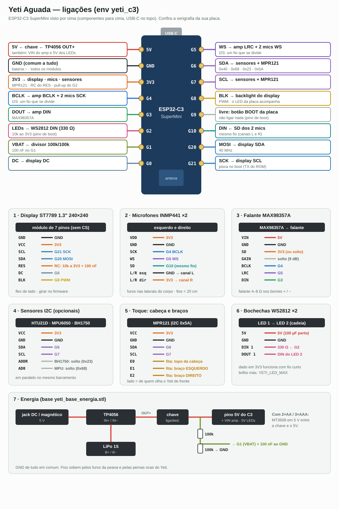

# Manual de montagem — Yeti Aguada (ESP32-C3)

Variante do Yeti no **ESP32-C3 SuperMini**, env **`yeti_c3`**. Mesmo firmware, mesmas peças
impressas e mesmo uso do [Yeti S3](MONTAGEM_YETI_S3.md) — este documento traz só **o que
muda**. Uso no dia a dia: [MANUAL_USUARIO_YETI.md](MANUAL_USUARIO_YETI.md).



> Diagrama gerado por `wiring_src/yeti.py` (argumento `c3`). Placa vista por cima,
> USB-C no topo. **Confira a serigrafia** da sua SuperMini antes de soldar.

## O que muda em relação ao S3

| | S3 | C3 |
|---|---|---|
| Toque da cabeça | TTP223 em G44 | **MPR121** eletrodo **E0** (fita de cobre) |
| Toque dos braços | touch nativo G3 / G13 | **MPR121** eletrodos **E1** (esq.) / **E2** (dir.) |
| Rosto | 25 fps, sprite 16 bit | **15 fps**; sprite 8 bit se faltar RAM (cores um pouco mais chapadas) |
| GPIO | 15 de 15 | 13 de 13 (G9 = botão BOOT, livre) |
| Partição | `default.csv` | `huge_app.csv` (3 MB de app, sem OTA) |

O **MPR121** (módulo I2C, 0x5A) entra no mesmo barramento dos sensores e lê as três fitas
de cobre. Assim o toque não gasta GPIO e o C3, que não tem touch nativo, fecha a conta.

---

## 1. Material (além da lista do S3)

| Qtd | Item | Observação |
|----:|------|------------|
| 1 | ESP32-C3 SuperMini | no lugar do S3 |
| 1 | **MPR121** (módulo de 12 eletrodos, I2C) | ADDR no GND = 0x5A (padrão dos módulos) |
| 3 | Fita de cobre adesiva ~12 × 15 mm | cabeça (maior, ~20 × 20 mm) e dois braços |
| 1 | Resistor 10 kΩ | pull-up do G2 (pino de boot) |
| — | **Sem** TTP223 | |

---

## 2. Pinagem

| C3 | Sinal | Vai para |
|----|-------|----------|
| **5V** | entrada | OUT+ do TP4056 (pela chave), VIN do MAX98357A, 5V dos LEDs |
| **GND** | terra | todos os módulos |
| **3V3** | saída 3,3 V | display, mics, sensores, MPR121, RC do RES, pull-up do G2 |
| **G4** | I2S BCLK | BCLK do amp **e** SCK dos 2 mics |
| **G5** | I2S WS | LRC do amp **e** WS dos 2 mics |
| **G3** | I2S DOUT | DIN do amp |
| **G10** | I2S DIN | SD dos 2 mics (mesmo fio) |
| **G6 / G7** | I2C SDA / SCL | HTU21D, MPU6050, BH1750, **MPR121** |
| **G21** | SPI SCK | display **SCL** |
| **G20** | SPI MOSI | display **SDA** |
| **G0** | DC | display **DC** |
| **G8** | backlight | display **BLK** |
| **G1** | ADC bateria | meio do divisor 100k/100k (+ 100 nF) |
| **G2** | LEDs | 330 Ω → DIN do 1º WS2812, **10 kΩ ao 3V3** |
| G9 | botão BOOT | livre — não ligar nada |
| — | reset do display | RES → 10 kΩ ao 3V3 + 100 nF ao GND (igual ao S3) |

I2S igual ao `communicator_c3` (G4/G5/G3/G10).

**MPR121:**

| Pino | Ligar em |
|------|----------|
| VCC / GND | 3V3 / GND |
| SDA / SCL | G6 / G7 |
| **E0** | fita do topo da cabeça |
| **E1** | fita do braço **esquerdo** (de quem olha de frente) |
| **E2** | fita do braço **direito** |
| ADDR | GND (0x5A) — na maioria dos módulos já vem assim |
| IRQ | solto (o firmware lê por polling a 50 Hz) |

**Pinos com cuidado:**
- **G2, G8, G9** são strapping e precisam estar **altos no boot**. G2 tem o pull-up de
  10 kΩ; G8 (BLK do display) já tem pull-up no módulo e no LED da placa; G9 fica livre.
- **G8** também é o LED azul da placa: ele acompanha o brilho do backlight. Só visual.
- **G21** é o TX da UART0: o ROM solta o log de boot ali, então o display pode receber lixo
  por ~1 s antes do firmware assumir. Normal.

---

## 3. Montagem

Siga a [montagem do S3](MONTAGEM_YETI_S3.md#3-montagem), trocando:

- **Passo 5 (cabeça):** em vez do TTP223, uma fita de cobre de ~20 × 20 mm por dentro do
  topo da cabeça, com fio até o **E0** do MPR121.
- **Passo 6 (braços):** as fitas dos braços vão ao **E1** (esquerdo) e **E2** (direito), não
  ao ESP.
- **MPR121:** fixe-o no meio do corpo, para os três fios das fitas ficarem curtos (< 10 cm)
  e longe do flex do display e do falante.
- **Passo 7 (bochechas):** dado no **G2** com 330 Ω em série e **10 kΩ do G2 ao 3V3**.
- Demais ligações pela tabela acima.

---

## 4. Gravação

```bash
cd ~/Dev/aguada-firmware/firmware/communicator
~/.platformio/penv/bin/pio run -e yeti_c3 -t upload
~/.platformio/penv/bin/pio device monitor -b 115200
```

| Flag extra | Padrão | Efeito |
|------------|--------|--------|
| `YETI_MPR_TOUCH` | 8 | limiar de toque do MPR121 (menor = mais sensível) |
| `YETI_MPR_RELEASE` | 4 | limiar de soltura (sempre menor que o de toque) |
| `YETI_FPS` | 15 | quadros por segundo do rosto |

As outras flags (`COMM_*`, `YETI_TFT_ROTATION`, `YETI_LED_MAX`…) são as mesmas do S3.

---

## 5. Teste de bancada

Igual ao [checklist do S3](MONTAGEM_YETI_S3.md#5-teste-de-bancada), com estas linhas no serial:

| Linha | Significa |
|-------|-----------|
| `[i2c] scan: 0x23 0x40 0x5A 0x68` | sensores **e o MPR121** responderam |
| `HTU21D ok, IMU ok, BH1750 ok, MPR121 ok` | `MPR121 --` = toque desligado |
| `braços: MPR121 E1/E2 ok` | braços pelo MPR121 |
| `[face] sprite 16 bit, heap livre …` | sobrou RAM para o sprite cheio (8 bit = modo econômico) |

## 6. Diagnóstico (só o que é do C3)

| Sintoma | Causa provável | Ação |
|---------|----------------|------|
| Não entra no programa (fica em modo download) | G9 ou G2 baixo no boot | nada no G9; 10 kΩ do G2 ao 3V3 |
| `MPR121 --` | SDA/SCL, ADDR fora do GND | conferir G6/G7; ADDR → GND |
| Toque não pega | parede grossa, fita pequena | baixar `YETI_MPR_TOUCH` (ex. 5) |
| Toque dispara sozinho | fio da fita longo ou perto do display | encurtar; subir `YETI_MPR_TOUCH` (ex. 12) |
| Rosto travando com voz | CPU única dividida | baixar `YETI_FPS` (ex. 12) |
| `sprite 8 bit` | heap curto depois do WiFi | normal no C3; cores levemente chapadas |
