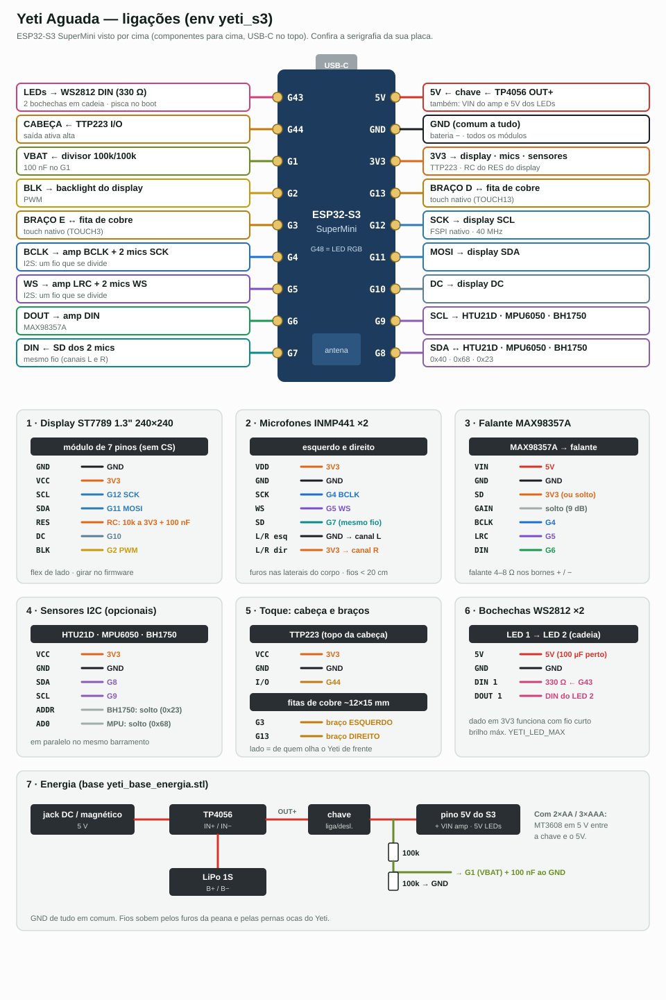

# Manual de montagem — Yeti Aguada (ESP32-S3)

Boneco de mesa impresso em 3D (Yeti v1.2 modificado) com rosto num display ST7789 1.3",
dois microfones, alto-falante, toque na cabeça e nos braços, bochechas de LED, sensores de
clima, movimento e luz, e bateria. **É um communicator:** fala e ouve anúncios por PTT e
reage aos alarmes do Aguada. Firmware: env **`yeti_s3`** (ESP-NOW canal 11). Uso no dia a
dia: [MANUAL_USUARIO_YETI.md](MANUAL_USUARIO_YETI.md). Projeto e comportamento:
[../YETI.md](../YETI.md). Tempo de bancada: ~3 h (sem contar a impressão).



> Diagrama gerado por `wiring_src/yeti.py`. A placa está vista por cima (componentes para
> cima, USB-C no topo). **Confira a serigrafia** da sua SuperMini antes de soldar.

Os módulos opcionais são detectados no boot: sem sensores, sem LEDs ou sem bateria, o Yeti
funciona com o que tiver.

---

## 1. Material

### Eletrônica

| Qtd | Item | Observação |
|----:|------|------------|
| 1 | **ESP32-S3 SuperMini** | 4 MB flash; os 15 GPIO são usados |
| 1 | Display **ST7789 1.3" 240×240 IPS**, SPI, módulo de **7 pinos** (sem CS) | GND VCC SCL SDA RES DC BLK |
| 2 | Microfone **INMP441** (módulo I2S) | um em cada lateral |
| 1 | **MAX98357A** + alto-falante 4–8 Ω, ≤ 3 W (Ø 20–28 mm) | |
| 1 | **TTP223** (módulo de toque capacitivo) | topo da cabeça |
| 2 | Fita de cobre adesiva ~12 × 15 mm | toque dos braços |
| 2 | **WS2812B** (LED endereçável avulso ou em placa de 1 LED) | bochechas |
| 1 | **HTU21D** (GY-21) | temperatura e umidade — opcional |
| 1 | **MPU6050** (GY-521) — ou MPU6500/9250 | movimento — opcional |
| 1 | **BH1750** (GY-302) | luz — opcional |
| 1 | **TP4056** com proteção (6 pinos: IN+ IN− B+ B− OUT+ OUT−) | carga |
| 1 | LiPo 1S 3,7 V (500–1200 mAh, cabe na base) | ou 2×AA/3×AAA + MT3608 em 5 V |
| 1 | Chave liga/desliga mini | |
| 1 | Jack DC fêmea e/ou conector magnético 5 V | entrada de carga |
| 2 | Resistor 100 kΩ | divisor da bateria |
| 1 | Resistor 10 kΩ | RC do reset do display |
| 1 | Resistor 330 Ω | série no dado dos LEDs |
| 2 | Capacitor 100 nF cerâmico | ADC da bateria e RC do display |
| 1 | Capacitor 100 µF / 10 V eletrolítico | 5V dos LEDs e do amp |
| — | Fio flexível 28–30 AWG (silicone), termo-retrátil, cola quente | |

### Peças impressas

| Peça | Arquivo | Obs. |
|------|---------|------|
| Corpo com rosto | `yeti_corpo_v2.stl` (gerado por `yeti_edit.py`) | furos dos mics nas laterais, marcas de toque nos braços |
| Moldura do display | `frame_st7789_1p3.stl` (gerada por `frame_st7789_1p3.py`) | janela 24,2 × 24,2 mm, imprimir com a frente para cima |
| Peana | `obj_2_Yeti Full.stl_7.stl` | base redonda Ø 90 mm |
| Base de energia | `yeti_base_energia.stl` (`yeti_base_energia.py`) | copo Ø 94 mm sob a peana: TP4056, bateria, chave, jack |
| Tampa traseira | `obj_4_Yeti Full.stl_3.stl` | abertura do USB-C |
| Skins (opcionais) | `yeti_skin_cmasm_chapeu.stl`, `yeti_skin_cmasm_bibico.stl` | chapéu e bibico |

Scripts e STLs próprios: [../cad/yeti/](../cad/yeti/README.md). As demais peças vêm do Yeti v1.2 original. PLA branco de 1,5–2 mm de parede deixa passar a
luz das bochechas e o toque capacitivo dos braços.

---

## 2. Pinagem

| S3 | Sinal | Vai para | Cor sugerida |
|----|-------|----------|--------------|
| **5V** | entrada | OUT+ do TP4056 (pela chave), VIN do MAX98357A, 5V dos LEDs | vermelho |
| **GND** | terra | todos os módulos, B− / OUT− | preto |
| **3V3** | saída 3,3 V | display, mics, TTP223, sensores, RC do RES, SD do MAX98357A | laranja |
| **G4** | I2S BCLK | BCLK do amp **e** SCK dos 2 mics (um fio que se divide) | azul |
| **G5** | I2S WS | LRC do amp **e** WS dos 2 mics | roxo |
| **G6** | I2S DOUT | DIN do amp | verde |
| **G7** | I2S DIN | SD dos 2 mics (mesmo fio) | ciano |
| **G8 / G9** | I2C SDA / SCL | HTU21D, MPU6050, BH1750 | lilás |
| **G12** | SPI SCK | display **SCL** | azul-claro |
| **G11** | SPI MOSI | display **SDA** | azul-claro |
| **G10** | DC | display **DC** | cinza |
| **G2** | backlight | display **BLK** | amarelo |
| **G1** | ADC bateria | meio do divisor 100k/100k (+ 100 nF ao GND) | verde-oliva |
| **G3** | touch nativo | fita de cobre do braço **esquerdo** | âmbar |
| **G13** | touch nativo | fita de cobre do braço **direito** | âmbar |
| **G44** | touch da cabeça | TTP223 **I/O** | âmbar |
| **G43** | LEDs | 330 Ω → DIN do 1º WS2812 | rosa |
| — | reset do display | **RES → 10 kΩ ao 3V3 + 100 nF ao GND** (sem GPIO) | |
| G48 | LED RGB da placa | nada a ligar | |

Esquerdo/direito = de quem olha o Yeti de frente.

**Configuração dos módulos (jumpers):**

| Módulo | Pino | Ligar em | Sem isso |
|--------|------|----------|----------|
| INMP441 esquerdo | L/R | **GND** | os dois mics no mesmo canal: some a direção do som |
| INMP441 direito | L/R | **3V3** | idem |
| MAX98357A | SD (SD_MODE) | **3V3** (ou solto) | ao GND = amplificador desligado |
| MAX98357A | GAIN | solto (9 dB) | ao GND = 12 dB, ao 3V3 = 6 dB |
| TTP223 | jumper A | **aberto** (saída alta no toque) | fechado → gravar com `-DYETI_TOUCH_ACTIVE=LOW` |
| TTP223 | jumper B | aberto (momentâneo) | fechado = liga/desliga: o PTT trava |
| BH1750 | ADDR | solto (0x23) | ao 3V3 = 0x5C (também é aceito) |
| MPU6050 | AD0 | solto (0x68) | ao 3V3 = 0x69 (também é aceito) |

**Pinos com cuidado:**
- **G43** é o TX da UART0: o ROM solta o log de boot ali, então os LEDs podem piscar
  aleatório por ~1 s no boot. Normal. O console é o USB nativo.
- **G3** é strapping (fonte do JTAG), mas só pesa com eFuse queimado; a fita de cobre não
  força nível no boot.
- **G44** (RX da UART0) é entrada no boot: seguro para a saída do TTP223.

---

## 3. Montagem

1. **Impressão:** imprima tudo e teste o encaixe da moldura na abertura do rosto e da
   peana na base de energia antes de soldar qualquer coisa.
2. **Display e moldura:** encaixe a moldura no rosto, apoie o display por trás com o **flex
   para o lado** e confira se a área visível fica inteira e centrada na janela. Fixe com
   cola quente nas bordas do PCB (nunca no vidro). Solde o RC do RES direto nos pinos do
   módulo: 10 kΩ de RES ao VCC e 100 nF de RES ao GND.
3. **Microfones:** um em cada furo lateral, com o **furo do mic** alinhado ao furo do corpo
   e uma gaxeta de espuma em volta. L/R do esquerdo no GND, do direito no 3V3. SCK, WS e SD
   dos dois em paralelo (G4, G5, G7). **Fios do I2S < 20 cm**, longe do falante.
4. **Falante:** no peito ou nas costas, virado para fora, **longe dos mics**. Falante nos
   bornes + / − do MAX98357A (nunca um lado ao GND). 100 µF entre VIN e GND junto ao amp.
5. **Toque da cabeça:** TTP223 colado por dentro do topo da cabeça, com a face do sensor
   encostada na parede (≤ 2 mm de PLA). I/O → G44.
6. **Toque dos braços:** fita de cobre de ~12 × 15 mm colada por dentro de cada braço, atrás
   da covinha. Fio curto soldado na fita (esquerdo → G3, direito → G13), longe do flex do
   display. **Não toque nos braços no boot** — é quando a linha de base é medida.
7. **Bochechas:** um WS2812 atrás de cada bochecha, encostado no PLA. G43 → 330 Ω → DIN do
   LED 1; DOUT do LED 1 → DIN do LED 2. 5V e GND nos dois.
8. **Sensores I2C:** os três em paralelo em G8/G9.
   - **HTU21D** longe do ESP e do backlight, numa abertura da base (perto deles lê 2–4 °C a mais).
   - **BH1750** atrás de um furo de ~3 mm na face, virado para a frente.
   - **MPU6050** preso firme ao corpo (cola quente ou parafuso), com o lado dos componentes
     para a frente.
9. **Energia (base):** jack/conector magnético → IN+ / IN− do TP4056; bateria em B+ / B−;
   OUT+ → chave → pino **5V** do S3 e VIN do amp; OUT− no GND. Divisor 100k/100k entre o
   lado de saída da chave e o GND, meio → G1, 100 nF de G1 ao GND. Os fios sobem pelos furos
   da peana e pelas pernas ocas do Yeti.
   - LiPo 1S vai direto no 5V (o LDO da placa segura até ~3,5 V).
   - Com pilhas: MT3608 ajustado em **5,0 V** entre a chave e o 5V (e sem TP4056).
10. **Conferência com o S3 fora e multímetro:**
    - 5V–GND e 3V3–GND: **sem curto**.
    - L/R do mic esquerdo–GND = 0 Ω; do direito–3V3 = 0 Ω.
    - RES do display–VCC do display ≈ 10 kΩ.
    - G1–GND entre 50 e 100 kΩ (divisor).
11. **Primeira energização sem o S3:** chave ligada → **3,7–4,2 V** (LiPo) ou **5,0 V**
    (pilhas + MT3608) no fio do 5V. Nenhum outro fio com tensão.
12. Desligue, solde/encaixe o S3, feche o corpo com a tampa traseira (USB-C na abertura).

---

## 4. Gravação

```bash
cd ~/Dev/aguada-firmware/firmware/communicator
cp secrets.ini.example secrets.ini        # preencher wifi_ssid / wifi_pass
~/.platformio/penv/bin/pio run -e yeti_s3 -t upload
~/.platformio/penv/bin/pio device monitor -b 115200
```

Se a placa não aparecer: segure **BOOT**, aperte e solte **RESET**, solte BOOT e grave de novo.

**Ajustes por `-D`** (em um env próprio, como no communicator):

```ini
[env:yeti_sala]
extends     = env:yeti_s3
build_flags = ${env:yeti_s3.build_flags}
    -DCOMM_NAME='"SALA"'
    -DCOMM_ZONE=1
    -DYETI_TFT_ROTATION=3
```

| Flag | Padrão | Efeito |
|------|--------|--------|
| `COMM_NAME` / `COMM_ZONE` / `COMM_PRIO` | YETI / 0 / 1 | iguais aos do communicator |
| `COMM_VOLUME_DEFAULT` | 50 | volume ao ligar (%) |
| `YETI_TFT_ROTATION` | 1 | 0..3: gira a imagem conforme o display foi montado |
| `YETI_TOUCH_ACTIVE` | HIGH | LOW se o jumper A do TTP223 foi fechado |
| `YETI_ARM_ON` / `YETI_ARM_OFF` | 1.04 / 1.02 | sensibilidade do toque dos braços |
| `YETI_LED_MAX` | 120 | teto de brilho das bochechas (0..255) |
| `YETI_VBAT_DIV` | 2.0 | razão do divisor da bateria |

Os pinos também podem ser trocados por `-D` (`include/yeti_config.h` e `COMM_PIN_I2S_*` no
`platformio.ini`); se trocar, regere o diagrama (`wiring_src/yeti.py`).

**WiFi:** rede 2,4 GHz no **canal 11**, multicast liberado — igual ao communicator.

---

## 5. Teste de bancada

**No serial**, logo após o boot:

| Linha | Significa |
|-------|-----------|
| `[i2c] scan: 0x23 0x40 0x68` | os três sensores responderam |
| `HTU21D ok, IMU ok, BH1750 ok` | sensores iniciados (`--` = ausente) |
| `I2S 16000 Hz … — mic OK` | mic achado |
| `braços: base E=… D=… (toque > x1.04)` | linha de base do toque dos braços |
| `leds ok, bateria 3.95 V` | LEDs e divisor da bateria |
| `YETI_BOOT node=0x… wifi=ok … mic=1 estereo=1 vbat=3.95` | resumo; `estereo=1` = os dois mics |
| `YETI t=24.1C rh=55% lux=180 a=(…)` | a cada 10 s: leitura dos sensores |

**Checklist:**

- [ ] **Display:** "iniciando..." e depois os olhos. Imagem deslocada ou de lado →
      `YETI_TFT_ROTATION`. Cores trocadas → `invert` / `rgb_order` em `src/yeti/face.cpp`.
- [ ] **Som:** arpejo de 4 notas ao ligar.
- [ ] **Cabeça:** 1 toque → olhos ^ ^ e piado; 2 toques → tela de clima + `bateria NN%`;
      3 toques → `volume NN%`.
- [ ] **Braços:** direito → `sim` + bochechas verdes; esquerdo → `nao` + vermelhas; os dois
      juntos → abraço (rosa). No serial: `YETI_EVT braco=…`.
- [ ] **IMU:** inclinar para a direita leva o olhar para a direita (se inverter, trocar o
      sinal em `mood_tick()`); chacoalhar → olhos de espiral.
- [ ] **Mics:** estalar os dedos de um lado → olhos viram para o lado do som.
- [ ] **Luz:** mão sobre o BH1750 por 30 s → dorme (tela quase apagada, bochechas apagadas);
      um toque acorda.
- [ ] **PTT:** com outro communicator ligado, segurar a cabeça → gongo e voz no outro; o
      Yeti fica verde com a boca mexendo.
- [ ] **Alarme:** disparar o alarme num communicator → Yeti vermelho piscando e sirene no falante.
- [ ] **Bateria:** tirar o USB → continua ligado; `vbat` no serial cai devagar com o uso.

---

## 6. Diagnóstico

| Sintoma | Causa provável | Ação |
|---------|----------------|------|
| Tela preta, backlight aceso | SCL/SDA trocados, DC errado, RES sem o RC | conferir G12/G11/G10; RES com 10k + 100 nF |
| Tela apagada | BLK solto ou em G2 errado | BLK → G2 |
| Imagem com faixa de lixo de 80 px | rotação errada para este módulo | testar `YETI_TFT_ROTATION` 0..3 |
| `mic ausente` | SD fora do G7, VDD sem 3V3 | medir 3V3 no mic, conferir G7 |
| `estereo=0` com os 2 mics | L/R dos dois no mesmo nível | esquerdo GND, direito 3V3 |
| Sem som | SD do MAX98357A no GND, DIN/BCLK trocados | SD em 3V3; conferir G6/G4/G5 |
| Toque da cabeça não responde / PTT trava | jumper A ou B do TTP223 | A aberto (ou `YETI_TOUCH_ACTIVE=LOW`); B aberto |
| Braço dispara sozinho | fio da fita longo / perto do display, ou tocado no boot | encurtar o fio; subir `YETI_ARM_ON`; religar sem tocar |
| Braço não pega | parede grossa, fita pequena | baixar `YETI_ARM_ON` (ex. 1.02) |
| LEDs não acendem | DIN/DOUT invertidos, sem 5V | seta do LED: DIN vem do G43 |
| Temperatura alta demais | HTU21D perto do ESP/backlight | mover para a abertura da base |
| `bateria` não aparece | divisor ausente ou G1 < 1,25 V | conferir os 100k e o fio no G1 |
| Reinicia ao tocar alto | bateria fraca ou sem 100 µF | carregar; 100 µF junto ao amp |
| `[i2c] scan: nenhum` | SDA/SCL trocados, sensores sem 3V3 | G8 = SDA, G9 = SCL |
