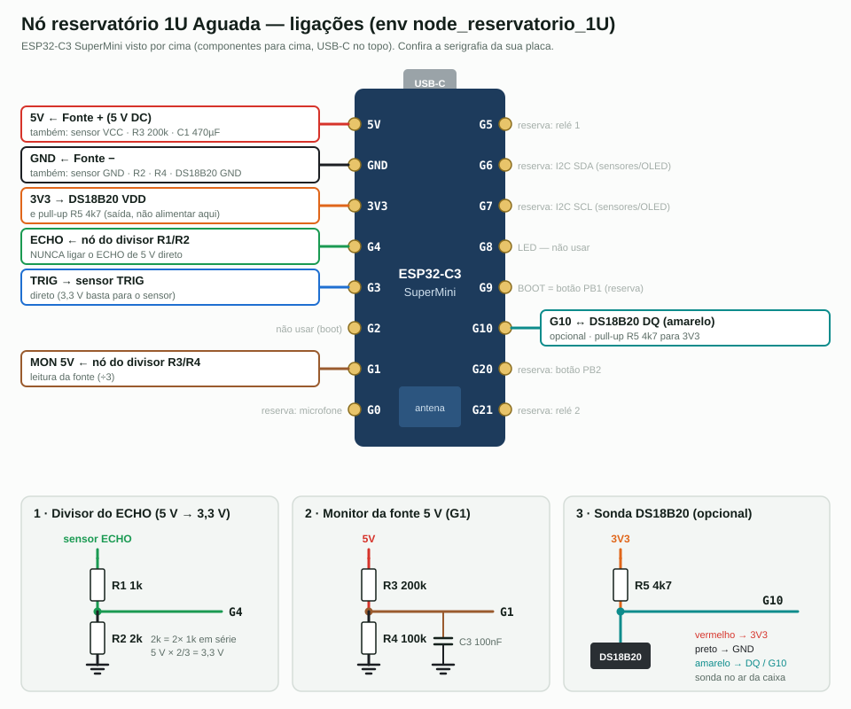

# Manual de montagem — Nó reservatório Aguada 1U (1 reservatório)

ESP32-C3 SuperMini + sensor ultrassônico (HC-SR04 ou JSN-SR04T) + fonte 5 V DC.
Firmware: env **`node_reservatorio_1U`** (ESP-NOW canal 11). Versão de 2 reservatórios: [MONTAGEM_NODE_RESERVATORIO_2U.md](MONTAGEM_NODE_RESERVATORIO_2U.md). Tempo de bancada: ~1 h.



> Diagrama gerado por `wiring_src/node_reservatorio.py ... 1U`. A placa está vista por cima
> (componentes para cima, USB-C no topo). **Confira a serigrafia** da sua SuperMini antes de soldar.

---

## 1. Material

| Qtd | Item | Observação |
|----:|------|------------|
| 1 | ESP32-C3 SuperMini | |
| 1 | Sensor ultrassônico | **JSN-SR04T / AJ-SR04M** (à prova d'água, mede a partir de ~25 cm) para campo; HC-SR04 só em bancada |
| 1 | Fonte 5 V DC, ≥ 1 A | |
| 1 | R1 1 kΩ | divisor do ECHO |
| 1 | R2 2 kΩ | ou 2× 1 kΩ em série |
| 1 | R3 200 kΩ | monitor da fonte (ou 2× 100 kΩ em série) |
| 1 | R4 100 kΩ | monitor da fonte |
| 1 | C1 470 µF / 10 V eletrolítico | 5V–GND, junto ao C3 |
| 1 | C2 100 nF cerâmico | 5V–GND, junto ao C3 |
| 1 | C3 100 nF cerâmico | G1–GND (estabiliza a leitura) |
| 1 | C4 100 µF / 10 V | 5V–GND, junto ao sensor |
| 1 | *(opcional)* sensor de temperatura: **HTU21D/SHT3x** (I2C) **ou** DS18B20 à prova d'água + R5 4,7 kΩ | compensação da velocidade do som + temperatura no painel; o nó detecta sozinho no boot |
| 1 | Placa perfurada, bornes, caixa IP65, prensa-cabo | |

---

## 2. Pinagem

| C3 | Sinal | Vai para | Cor sugerida |
|----|-------|----------|--------------|
| **5V** | entrada 5 V | Fonte +, sensor VCC, topo do R3, C1/C2 | vermelho |
| **GND** | terra | Fonte −, sensor GND, R2, R4, C1–C4, DS18B20 preto | preto |
| **3V3** | saída 3,3 V | DS18B20 VDD + R5 (só isso) | laranja |
| **G3** | TRIG | sensor TRIG, direto | azul |
| **G4** | ECHO | nó R1/R2 (**nunca** o ECHO direto) | verde |
| **G1** | monitor 5 V | nó R3/R4 + C3 | marrom |
| **G10** | 1-Wire | DS18B20 DQ (amarelo) + R5 para 3V3 | ciano |
| **G6 / G7** | I2C SDA / SCL | HTU21D/SHT3x (opcional; VCC no 3V3) — o OLED futuro divide o mesmo barramento | roxo / cinza |
| G8 | — | **não usar** (pino de boot; LED da placa) | |
| G0, G2, G5–G7, G9, G20, G21 | — | **reservados** (tabela abaixo) | |

**Pinos reservados para expansão** (ainda sem firmware — não usar para outra coisa):

| C3 | Reserva | Cuidado |
|----|---------|---------|
| **G0 / G2 / G21** | Microfone **INMP441** (I2S): G0 → SCK, G2 → WS, G21 ← SD; VDD 3V3, GND, L/R → GND | detectar água entrando pelo ruído. G2 é pino de boot: só o WS do mic nele. Fios curtos (< 20 cm) |
| **G6 / G7** | OLED SSD1306 (0x3C) na mesma I2C do sensor de temperatura | pull-up 4k7 se nenhum módulo tiver |
| **G5** | Saída: relé | pino mais seguro para saída. 2º relé: expansor I2C (PCF8574) na G6/G7 |
| **G9** | Entrada: botão PB1 (é o botão BOOT da placa) | |
| **G20** | Entrada: botão PB2 (pull-up interno, botão ao GND) | |

Relé: módulo acionado por 3,3 V (transistor/optoacoplador), bobina no 5 V.

**Por que o divisor no ECHO:** o sensor alimentado em 5 V devolve um pulso de 5 V, e o C3 só
aguenta 3,6 V nas entradas. Sem o divisor o pino queima — já aconteceu no nó CON (G0).

**Divisores:**

```
sensor ECHO ── R1 1k ──┬── G4          5V ── R3 200k ──┬──┬── G1
                       │                               │  │
                     R2 2k                          R4 100k  C3 100nF
                       │                               │  │
                      GND                             GND GND
     5 V × 2/3 = 3,3 V em G4               5 V ÷ 3 = 1,67 V em G1
```

---

## 3. Montagem

1. **Fonte:** meça a saída sem carga: **5,0 a 5,3 V**.
2. **Placa perfurada:** solde barra de pinos fêmea para o C3 (ele fica removível) e bornes para
   fonte, sensor e sonda.
3. **Barramentos:** trilha de 5V e trilha de GND. Solde C1 + C2 encostados nos pinos 5V/GND do C3
   (observe a polaridade do C1) e C4 junto ao borne do sensor.
4. **Divisor do ECHO:** R1 entre o borne ECHO e o pino G4; R2 entre G4 e GND.
5. **Monitor da fonte:** R3 entre 5V e G1; R4 e C3 entre G1 e GND.
6. **TRIG:** fio direto do borne TRIG ao G3.
7. **Temperatura (opcional, um dos dois):**
   - **HTU21D/SHT3x (I2C):** VCC no 3V3, GND, SDA no G6, SCL no G7. Tem prioridade se os dois existirem.
   - **DS18B20:** vermelho no 3V3, preto no GND, amarelo no G10; R5 4k7 entre G10 e 3V3.
   - Sem nenhum, o nó usa 25 °C fixos e não manda temperatura ao servidor.
8. **Conferência com o C3 fora do soquete e multímetro:**
   - 5V–GND: **sem curto**.
   - G4–GND: ~2 kΩ. G1–GND: ~67 kΩ (100k ∥ 200k).
   - Nenhum fio do sensor encostando no 3V3.
9. **Primeira energização ainda sem o C3** (só a fonte e o sensor):
   - soquete 5V: **5,0 V** · soquete G1: **~1,67 V** · soquete G4: **0 V** em repouso.
   - Se G4 ou G1 passarem de **3,3 V**, pare e revise os divisores.
10. Desligue a fonte e encaixe o C3.

> **Buck de 3,3 V:** com a fonte de 5 V ele é dispensável, porque o C3 já regula pelo pino 5V.
> Se usar mesmo assim: saída do buck no **3V3** do C3, sensor continua no **5V**, e **desligue a
> fonte antes de plugar o USB**.

---

## 4. Gravação

Com o C3 no USB do computador (fonte desligada). Apaga a flash inteira para o nó não usar
pinos antigos salvos no NVS:

```bash
cd ~/Dev/aguada-firmware/firmware/node
~/.platformio/penv/bin/pio run -e node_reservatorio_1U -t erase
~/.platformio/penv/bin/pio run -e node_reservatorio_1U -t upload
~/.platformio/penv/bin/pio device monitor -b 115200
```

Anote o MAC impresso no boot: os **2 últimos bytes** são o `node_id` (ex.: `…:AB:D6` → `0XABD6`).

---

## 5. Teste de bancada

Sensor apontado para uma parede a ~1 m, gateway ligado no servidor.

**No monitor serial**, em até 1 min:

| Linha | Significa |
|-------|-----------|
| `Mode: SENSOR (num_sensors=1)` | modo reservatório |
| `Sensor 1: TRIG=3 ECHO=4` | pinos certos (se aparecer 1/0, o NVS não foi apagado) |
| `gateway XX:XX:… → unicast` | gateway respondeu ao HELLO; envio com confirmação |
| `S1 dist: 100 cm` | leitura chegando (varia ±1–2 cm) |
| `WDT 60s` | watchdog ativo |
| `temperatura I2C …: HTU21D/HD21D 0x40` ou `sonda EXT detectada` | sensor de temperatura achado (sem sensor: `nenhum` / `sem sonda`) |

**LED da placa:** 2 piscadas no boot e 1 piscada curta a cada envio.

**Na ponta do servidor:** o nó aparece em http://192.168.0.26:8090 (aguada-web do lucmac). O pacote leva `vbat` ≈ 50 (5,0 V) e o RSSI.

**Cadastro do reservatório** em `tools/reservoirs.yaml` e depois rodar `tools/sync_reservoirs.sh`:

```yaml
  "0XABD6":
    - sensor_id: 1
      alias: NOVO
      name: Nome do reservatório
      level_max_cm: 200        # altura útil da água
      volume_max_L: 20000
      sensor_offset_cm: 30     # do sensor até o nível máximo (ver item 6)
```

---

## 6. Instalação no reservatório

- **Altura:** o sensor fica **≥ 25 cm acima do nível máximo** (zona cega do JSN-SR04T). Essa
  distância é o `sensor_offset_cm`: meça com trena, do sensor até a marca de transbordo.
- **Posição:** perpendicular à água, longe de paredes, escadas, boia e da entrada d'água (a queda
  d'água gera eco falso).
- **Eletrônica fora da caixa d'água:** só o transdutor entra. O C3 vai numa caixa IP65 com
  prensa-cabo, com laço de gotejamento no cabo, de preferência na sombra.
- **Antena:** a ponta da placa oposta ao USB voltada para o gateway, sem metal na frente. Antes
  de fechar a caixa, confira o RSSI: melhor que **−85 dBm**.
- **Sonda DS18B20 (opcional):** dentro da caixa d'água, no ar, perto do sensor e fora da água.
  Ao ligar a sonda, a escala muda ~2%, então recalibre o `sensor_offset_cm`.

---

## 7. Diagnóstico

| Sintoma | Causa provável | Ação |
|---------|----------------|------|
| `S1 dist: ERR` sempre | ECHO sem sinal: divisor aberto, sensor sem 5V ou TRIG/ECHO trocados | medir 5V no sensor; conferir G3=TRIG e G4=ECHO |
| Leitura fixa ~20–25 cm | objeto ou parede na frente, ou dentro da zona cega | reposicionar; respeitar 25 cm |
| Leitura pula muito | eco na parede ou na entrada d'água | afastar ou mirar o sensor |
| `Sensor 1: TRIG=1 ECHO=0` | NVS antigo | gravar de novo com `-t erase` |
| Nunca aparece `→ unicast` | gateway com firmware antigo ou longe | regravar o gateway (branch `feat/node-unicast-wdt-tempcomp`) ou usar `-DDEFAULT_GATEWAY_MAC` |
| `unicast sem ACK` frequente | sinal fraco | reposicionar a antena ou usar um relay |
| Tensão da fonte < 4,5 V (alerta de fonte baixa) | fonte fraca ou cabo longo | trocar a fonte ou encurtar o cabo |
| Reinicia sozinho a cada ~6 h | sem nenhuma entrega confirmada (gateway fora do ar) | verificar o gateway e o servidor |
